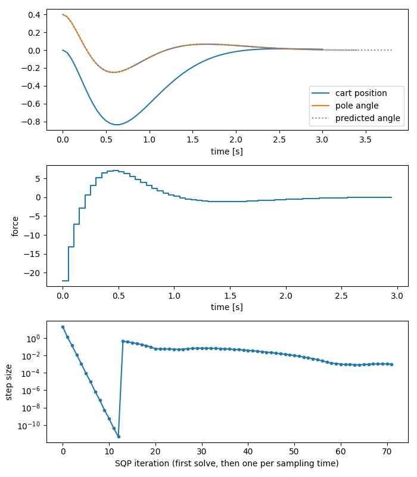

# Developing in Python, deploying in C

[`cartpole_workflow.py`](cartpole_workflow.py) is a Gauss-Newton SQP for
closed-loop MPC of a cart-pole (Riccati recursions for the QPs, dynamics and
derivatives from CasADi, an LQR terminal cost), written as one prometeo
program that is developed in Python and then transpiled to C without changes:

```
pmt cartpole_workflow.py                 # Python: checks, comparisons, plots
PMT_DEBUG=1 pmt cartpole_workflow.py     # the same, stopping in pdb after the first solve
pmt cartpole_workflow.py --cgen=True     # C: the same numbers, without the Python-only code
```

## Python-only code in pure blocks

Code between `# pure >` and `# pure <` lines is plain Python: it runs in
Python and is removed when transpiling. It can use any Python library and
read any prometeo variable; `np.array(A)` converts a matrix or vector to a
NumPy array. In the example, pure blocks:

- **check intermediate results**: every cost-to-go matrix of the Riccati
  recursion is checked to be symmetric positive definite (with
  `np.linalg.eigvalsh`), and `breakpoint()` stops in the debugger if it is
  not;
- **compare with independent solutions**: the terminal cost with SciPy's
  `solve_discrete_are`, the solution of the optimal control problem with
  IPOPT (through CasADi's `Opti`), with an `assert`:

  ```
  [python] terminal cost, difference from scipy: 1.8e-14
  [python] difference from IPOPT: 4.2e-12
  ```
- **log and plot**: the SQP step sizes, the closed-loop trajectory and the
  prediction made at each sampling time, plotted with matplotlib:

  

- **define the model**: the CasADi functions for the RK4 step and its
  Jacobians are built in a pure block, and called from prometeo code (in C,
  through code generated by CasADi).

## Debugging

The Python run executes the program's own lines (matrix expressions are
translated into calls with the same line numbers), so the usual tools work
on them:

- `breakpoint()` in a pure block stops in pdb, which shows the program's
  source; everything can be inspected, e.g. `p np.array(sqp.K[0])`, and `n`
  steps through the program line by line;
- errors (a size mismatch that can only be detected at run time, an index
  out of range) raise exceptions with a traceback that points to the line of
  the program.

## How the example was debugged

The plots and checks above found two problems while writing this example:

1. Without a terminal cost, the predicted trajectories curved away from the
   closed loop at the end of the horizon: with only 1 s of horizon the
   optimizer lets the pole fall just after it. The terminal cost is now the
   LQR cost-to-go at the upright position.
2. The first version of that terminal cost (iterating the Riccati recursion
   300 times) gave NaN. The positive-definiteness check stopped the program;
   printing the cost-to-go in a pure block showed that it converges after
   about 100 iterations, then drifts and diverges: the recursion does not
   preserve symmetry exactly, and rounding errors in the antisymmetric part
   grow with the unstable mode of the pendulum. Symmetrizing the matrix at
   each iteration fixed it, and the comparison with SciPy confirms the
   result.

## Rules for pure blocks

- The transpiled program must not depend on them: they can read prometeo
  variables, but must not modify them, else Python and C compute different
  things.
- The code must remain valid without them: e.g. a pure block cannot be the
  only statement of a loop body.
